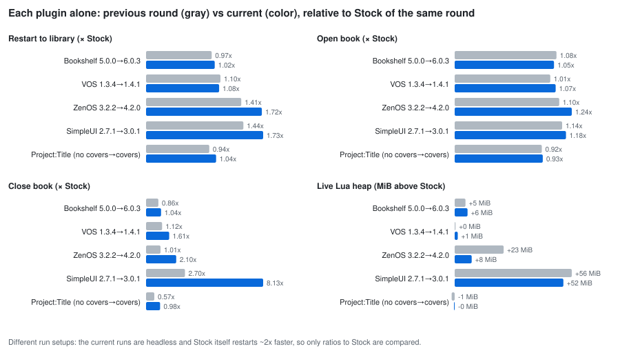
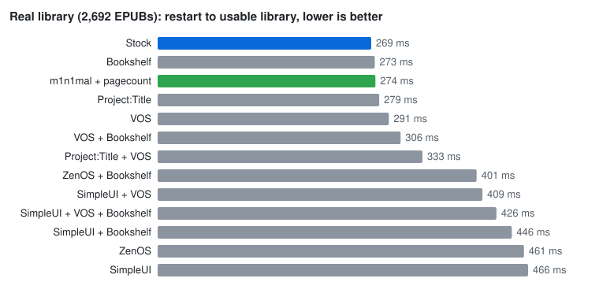
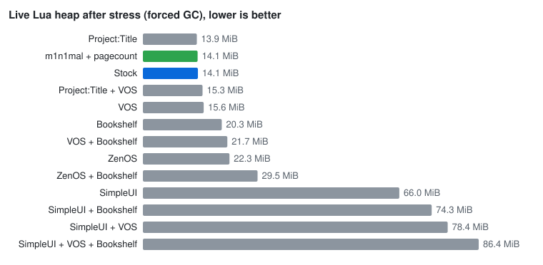
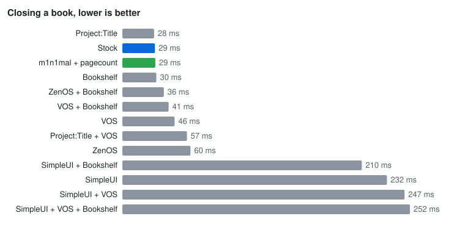
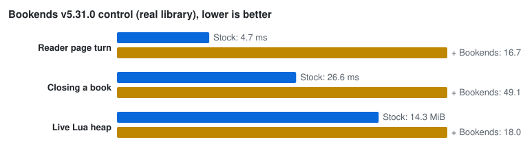

# KOReader UI Plugin Performance Benchmark

This repository measures the performance and retained runtime cost of KOReader UI plugins and plugin stacks in a pinned macOS SDL emulator.

It answers a practical question: **which UI changes stay close to Stock KOReader, and which trade more startup time or retained Lua state for a richer shell?**

> This is a controlled emulator comparison, not a benchmark of physical Kindle latency. It is useful for relative work, memory, and redraw comparisons; it cannot turn a Mac millisecond value into a Kindle millisecond value.

## Bottom line: how each plugin changed since the previous round

**Mixed, with no plugin better across the board.** ZenOS cut its retained memory the most, SimpleUI renders the library faster, Bookshelf stays close to Stock but its own shelf pages slower, and several plugins got relatively slower at closing a book. Details per plugin:




Previous round: campaign `2026-09-12-full` (SimpleUI 2.7.1, ZenOS 3.2.2, Bookshelf 5.0.0, VOS 1.3.4); current: the 2026-10-27 campaigns (SimpleUI 3.0.1, ZenOS 4.2.0, Bookshelf 6.0.3, VOS 1.4.1). Absolute times are not comparable between the rounds (the current runs are headless and Stock itself restarts about twice as fast), so the chart compares each plugin with Stock of the same round. Project:Title is the same release in both; its change is only that it now runs with covers.

- **ZenOS**: retained heap above Stock fell from +23 to +8 MiB; library render improved from 1.4x to 1.2x Stock. Restart, open and close got relatively slower.
- **SimpleUI**: library render improved (about 3.5x to 2.4x Stock) and heap is about the same (+56 to +52 MiB); closing a book got much slower (2.7x to 8.1x Stock).
- **Bookshelf**: close to Stock in both rounds (heap +5 to +6 MiB). Its own shelf is slower to page: 84 to 133 ms per page with the default animation, 26 to 38 ms with it off; shelf open and first render are slightly faster.
- **VOS**: about the same, a little heavier relative to Stock.

Two different harness setups and several plugin releases changed at once, so this shows direction, not the cause of any change.

## Quick links

- Campaigns of 2026-10-27 (reports with all scenarios): [all stacks, Phase 1](results/runs/2026-10-27-m1n1mal-v3/phase1/REPORT.md) and [Phase 2](results/runs/2026-10-27-m1n1mal-v3/phase2/REPORT.md); [Project:Title with covers](results/runs/2026-10-27-pt-covers/phase2/REPORT.md); [VOS v1.4.1 stacks](results/runs/2026-10-27-vos-141/phase2/REPORT.md); [Bookends control](results/runs/2026-10-27-bookends/phase2/BOOKENDS_REPORT.md). Each row in the tables below comes from the newest campaign that measured it.
- Earlier (older pins): [2026-09-03 Phase 1](results/runs/2026-09-03-full/phase1/REPORT.md), [Phase 2](results/runs/2026-09-03-full/phase2/REPORT.md), [100 ms flash-delay study](results/runs/2026-09-03-flash100/phase1/REPORT.md)
- [Campaign runbook](RUNBOOK.md) · [Scenario definitions](SCENARIOS.md)

## Results at a glance (2026-10-27)

Real library of 2,692 EPUBs, KOReader v2026.07.2 in the SDL emulator, every plugin on its latest stable release.

| | Result |
|---|---|
| **Fast and light** | Stock, Bookshelf, VOS, Project:Title (cover list on) and my own minimal plugin (m1n1mal + pagecount): restart 269–291 ms, 14–16 MiB live Lua heap (Bookshelf 20 MiB). |
| **Heaviest** | SimpleUI: restart 409–466 ms, 66–86 MiB heap, 210–250 ms to close a book (Stock: 29 ms). |
| **In between** | ZenOS: restart 461 ms, 22 MiB; adding Bookshelf to VOS or ZenOS costs about 7 MiB more heap. |
| **Bookends** | Page turn in the book 4.7 → 16.7 ms, closing a book 27 → 49 ms, +3.7 MiB heap. Small in absolute terms, not negligible. |
| **Bookshelf's own shelf** | Page turn 133 ms with the default animation, 38 ms (fastest 22 ms) with it off, versus 17.5 ms for Stock's list. A deliberate cost; the library rows for Bookshelf measure the stock browser (see below). |
| **Correction** | Project:Title's lead in the earlier report came from running without its cover list. With covers it is about as light as Stock, not clearly faster. |
| **Library paging** | 15–17.5 ms per page for every stack, distributions overlap: no ranking. |









**m1n1mal + pagecount** is my own minimal plugin pair (quick panel, corner status lines, background page counts on top of KOReader's own library). I made it for myself and have not published it yet; it is included only as a reference point.

Emulator on Apple Silicon, not a Kindle: read the numbers as relative. Tables for every stack, the synthetic libraries and the Bookends control follow below; `scripts/make_summary_charts.py` regenerates the charts from the published CSVs.

## Details: campaigns, tables and notes

**Test date: 2026-10-27** (all campaigns below, same host and pinned KOReader).
The current numbers come from four campaigns, each measuring only the configs
it names, all with the same harness behaviour for the scenarios they share:

- `2026-10-27-m1n1mal-v3`: all 14 stacks at the pins listed under *Pinned
  software* (VOS at v1.4). Its Project:Title and VOS rows are superseded.
- `2026-10-27-pt-covers`: Project:Title alone with the cover list enabled.
  (It also contains a Project:Title + VOS run on VOS v1.4, superseded below.)
- `2026-10-27-vos-141`: every VOS-containing stack on VOS v1.4.1.
- `2026-10-27-bookends`: the Stock versus Stock + Bookends reader control.

The tables take each row from the newest campaign that measured it. The
campaigns have different runner hashes (Project:Title's first-run setup is no
longer pre-marked done, `--configs` scopes the Phase 2 gate, VOS keeps
`hide_empty_folders` off, results carry a `library_probe`), so they are
separate campaigns rather than one.

Every cell below is an emulator measurement; see the limits in the next
section.

- **Stock, Bookshelf and m1n1mal + pagecount** are indistinguishable on the real
  library: steady restart to the library 269–274 ms, library render 25–27 ms,
  open book 105–111 ms (single-process differences of a few ms are inside the
  run-to-run spread). The forced-GC live Lua heap after the stress sequence is the same for Stock and
  m1n1mal + pagecount (14.1 MiB).
- **Project:Title with the cover list on** is no longer clearly ahead: restart
  279 ms, open book 98 ms, but a sort change is slower than Stock and
  m1n1mal (see the cover-list cost table). Earlier versions of this README
  credited it with a large lead; that was measured without covers.
- **SimpleUI** keeps its larger startup and memory cost: restart 409–466 ms,
  library render 51–66 ms, 66–86 MiB live Lua heap, and about 210–250 ms to close
  a book (Stock: 29 ms).
- **ZenOS** restarts in 461 ms and renders the library in 33 ms; its page holds 5
  entries, so paging comparisons are UX-level.
- **Bookshelf** leaves the normal library close to Stock. In its dedicated shelf,
  the default animation dominates page-turn latency; animation-off isolates a
  much smaller renderer cost.
- **VOS v1.4.1** is close to v1.4 on the real library (restart 291 ms, open book
  112 ms). On the synthetic FLAT 2000 library its render time is higher (66 versus
  49 ms for v1.4 in the baseline campaign); that is one process per cell and was not
  investigated further. Its new automatic series folders are on by default.
- **Library paging**: sequential 14.8–17.5 ms per page, cached 12.8–20.8 ms, for
  every stack; distributions overlap, so no paging ranking is claimed.

### Cover list cost, and how Project:Title is measured

A cover-list library (`list_image_meta`) costs more than the plain list. The
harness pre-marked Project:Title's first-run setup as done, so in campaigns up to
`2026-10-27-m1n1mal-v3` it never switched to its cover list, while every
CoverBrowser-based stack ran with covers (probe: `cover_build_ui=False` for
Project:Title). That compared a plain list with other stacks' cover lists.
The runner no longer pre-marks the setup, the `library_probe` field in each raw
result records the active mode, and Project:Title is now measured with covers
on (`cover_build_ui=true`, verified in all its warm results).

Controlled diagnostic (real 2692-book library, warm, median of 4 runs, ms;
not part of a published campaign):

| Stack | Open book (minimal) | Change sort | First render | Close book |
|---|---:|---:|---:|---:|
| Stock + cover list | 100.6 | 60.4 | 47.3 | 27.1 |
| m1n1mal + pagecount | 100.2 | 56.1 | 37.0 | 28.9 |
| Project:Title, covers on | 97.6 | 69.1 | 33.6 | 27.2 |
| Project:Title, no covers (the old measurement) | 94.9 | 39.4 | 26.2 | 24.3 |

Loading CoverBrowser with covers costs about 20 ms on a sort change, 17 ms on the
first render and 6–9 ms on opening a book, for every stack that uses it.

### Synthetic stress case: FLAT 2000

This table is the intentionally hostile case: 2,000 EPUBs in one folder. Values
are warm medians in milliseconds; every shown value has 10 measured samples after
two warmups, from a single process per stack. `Open book` is `open_book_minimal`,
isolated from dirty-region instrumentation. Differences of a few milliseconds are
inside the spread of one process; the Bookshelf, SimpleUI and LeanUI open-book values
include effects of their own shells.

| Stack | Library render | Open book |
|---|---:|---:|
| LeanUI (local rebuild) | 36.6 | 56.5 |
| m1n1mal + pagecount | 38.0 | 59.7 |
| Bookshelf | 38.6 | 122.3 |
| Stock | 38.9 | 59.3 |
| Project:Title | 44.1 | 50.9 |
| ZenOS + Bookshelf | 48.2 | 48.4 |
| ZenOS | 49.1 | 69.8 |
| VOS + Bookshelf | 60.8 | 75.7 |
| Project:Title + VOS | 61.0 | 45.5 |
| VOS | 66.1 | 47.9 |
| SimpleUI + VOS | 67.4 | 78.5 |
| SimpleUI + VOS + Bookshelf | 68.9 | 83.5 |
| SimpleUI + Bookshelf | 75.4 | 89.3 |
| SimpleUI | 78.1 | 90.5 |

### Real library: 2,692 EPUBs

`Real 2692` is the total corpus size. Real paging traverses the library root,
which contains exactly **505 visible entries: 500 EPUBs + 5 folders**. The other
2,192 EPUBs remain inside those folders and still participate in indexing,
metadata/cache growth, folder navigation and the remaining Phase 2 scenarios.

The real corpus is the more practically useful result set. Restart values are the median of three isolated process runs; render/open values are warm medians of 10 samples. Memory is one forced-GC checkpoint per stack after the same stress sequence, so it is an observed state point, not a replicated statistical median.

| Stack | Restart → library | Library render | Open book | Live Lua after stress (forced GC) |
|---|---:|---:|---:|---:|
| Stock | 269 ms | 26.8 ms | 105.5 ms | 14.1 MiB |
| Bookshelf | 273 ms | 25.5 ms | 110.7 ms | 20.3 MiB |
| m1n1mal + pagecount | 274 ms | 26.3 ms | 110.8 ms | 14.1 MiB |
| Project:Title | 279 ms | 30.4 ms | 98.1 ms | 13.9 MiB |
| VOS | 291 ms | 34.5 ms | 112.5 ms | 15.6 MiB |
| VOS + Bookshelf | 306 ms | 34.5 ms | 127.3 ms | 21.7 MiB |
| LeanUI (local rebuild) | 323 ms | 31.7 ms | 99.3 ms | 15.0 MiB |
| Project:Title + VOS | 333 ms | 45.9 ms | 104.6 ms | 15.3 MiB |
| ZenOS + Bookshelf | 401 ms | 39.8 ms | 123.7 ms | 29.5 MiB |
| SimpleUI + VOS | 409 ms | 51.2 ms | 123.6 ms | 78.4 MiB |
| SimpleUI + VOS + Bookshelf | 426 ms | 52.3 ms | 130.6 ms | 86.4 MiB |
| SimpleUI + Bookshelf | 446 ms | 60.1 ms | 118.6 ms | 74.3 MiB |
| ZenOS | 461 ms | 33.1 ms | 130.4 ms | 22.3 MiB |
| SimpleUI | 466 ms | 65.7 ms | 124.0 ms | 66.0 MiB |

`RSS` is recorded too, but it is the whole macOS emulator process. It includes native libraries, mappings, allocator behaviour, and cached allocations, so forced-GC live Lua heap is the cleaner plugin-side signal.

### Real-library paging

Warm medians (and, in brackets, the fastest iteration) of 30 transitions per stack in the Phase 2 library root (505 entries:
500 EPUBs + 5 folders). `Entries/page` is the visible page size; comparisons across
different layouts are UX-level, not equal-render-work claims. The dedicated
three-process paging phases were not repeated in this round.

| Stack | Entries/page | Sequential, ms: median (min) | Cached, ms: median (min) |
|---|---:|---:|---:|
| Project:Title | 7 | 14.8 (12.0) | 20.7 (8.5) |
| Project:Title + VOS | 7 | 15.1 (12.7) | 18.6 (9.0) |
| VOS | 10 | 15.4 (13.3) | 14.7 (9.1) |
| Bookshelf | 10 | 15.7 (9.9) | 14.5 (9.4) |
| SimpleUI | 9 | 15.9 (7.4) | 12.8 (10.4) |
| LeanUI (local rebuild) | 14 | 16.0 (12.7) | 16.1 (15.6) |
| SimpleUI + Bookshelf | 9 | 16.1 (7.5) | 13.1 (11.0) |
| SimpleUI + VOS + Bookshelf | 9 | 16.1 (7.3) | 14.3 (9.1) |
| ZenOS | 5 | 16.1 (5.5) | 16.1 (6.6) |
| ZenOS + Bookshelf | 5 | 16.1 (6.4) | 16.1 (6.5) |
| SimpleUI + VOS | 9 | 16.1 (7.3) | 14.7 (9.8) |
| VOS + Bookshelf | 10 | 16.1 (13.3) | 15.1 (8.8) |
| m1n1mal + pagecount | 10 | 17.4 (13.6) | 15.7 (10.6) |
| Stock | 10 | 17.5 (12.6) | 15.7 (9.5) |

The separate `2026-09-03-flash100` sensitivity study added approximately
97–106 ms to the median library transition. It is an injected SDL delay, not a
physical Kindle model.

### Bookends control

Bookends v5.31.0 was measured on 2026-10-27 as Stock versus Stock + Bookends on the
real library (`2026-10-27-bookends`), rather than multiplying every stack by another
on/off factor. One process per variant; heap samples are 10 repeated reader cycles
inside that process, not independent replicates.

| Metric | Stock | Stock + Bookends |
|---|---:|---:|
| Reader page turn (median) | 4.7 ms | 16.7 ms |
| Close book | 26.6 ms | 49.1 ms |
| Open book (minimal) | 99.5 ms | 103.5 ms |
| Forced-GC live Lua heap | 14.3 MiB | 18.0 MiB |
| Library paging (sequential / cached) | 16.7 / 16.9 ms | 17.9 / 18.3 ms |

Bookends is not negligible: it adds roughly 12 ms to a reader page turn (about 3.5x),
about 22 ms to closing a book and about 3.7 MiB of live heap, while library paging and
opening a book are within noise. For that reason it stays in the comparison as its own
control instead of being left out. A quick repeated check on the synthetic libraries
(4 runs per variant) showed the same pattern for close book (+25–30 ms) and heap
(+6–7 MiB); the synthetic books are single-page, so reader page turns can only be
measured on the real corpus.

## What was tested

The harness uses a backend-specific adapter for each UI stack. A scenario is `PASS` only when its semantic postcondition succeeds; unsupported UI actions remain `UNSUPPORTED` and are never converted into zero-latency samples.

Core scenarios include:

- process spawn to usable UI and usable library;
- library first render, page navigation, folder navigation, and sort change;
- open and close book;
- quick/settings panel transitions;
- short navigation stress and memory checkpoints;
- dedicated Bookshelf open/render/page/close scenarios;
- a separate Bookends reader control;
- refresh and dirty-region accounting.

The primary open-book number is `open_book_minimal`, which avoids distorting the latency with full dirty-region instrumentation. The report retains the full-instrumented scenario separately.

## Published campaign status

Campaigns [`2026-09-03-full`](results/runs/2026-09-03-full/campaign.json),
[`2026-09-03-bookends10-fixed`](results/runs/2026-09-03-bookends10-fixed/campaign.json)
and [`2026-09-03-flash100`](results/runs/2026-09-03-flash100/campaign.json) were
generated by the code and dependency revisions recorded in their metadata. These
are aggregated report rows, not a count of individual warm iterations:

| Scope | PASS | FAILED | UNSUPPORTED |
|---|---:|---:|---:|
| Baseline Phase 1 | 1,520 | 0 | 136 |
| Baseline Phase 2 | 611 | 0 | 6 |
| Bookends control | 38 | 0 | 2 |
| Flash100 paging study | 276 | 0 | 0 |

Campaigns `2026-10-27-m1n1mal-v3` and `2026-10-27-pt-covers` (14 stacks and the
Project:Title re-run) report 1,440 + 180 PASS in Phase 1 and 545 + 72 PASS in
Phase 2 with 0 FAILED; their UNSUPPORTED rows (156 + 20 and 8 + 2) are the same
kind of stack-specific gaps. `2026-10-27-vos-141` adds 498 + 196 PASS (Phase 1 and
2, 0 FAILED), and `2026-10-27-bookends` 38 PASS. The `2026-10-27-m1n1mal-v3`
Project:Title and VOS rows are superseded by `2026-10-27-pt-covers` and
`2026-10-27-vos-141`.

`UNSUPPORTED` entries describe actions that do not exist for the relevant stack or corpus shape, such as next-page navigation in a single-page library. They are reported explicitly rather than treated as success or as `0 ms`.

## Test environment

### Host and emulator target

- Apple MacBook Pro with M4 Pro, arm64
- macOS / Darwin 27
- Python 3.14.7
- KOReader SDL emulator hard-gated to 1236 × 1648, 300 DPI, grayscale
- Kindle Paperwhite 11th-generation / PW5-style framebuffer

SDL logical window size and actual render-output size can differ on Retina macOS. The runner aborts unless the actual framebuffer is 1236 × 1648.

### Pinned software

Only tagged stable releases are pinned. Pre-release tags are deliberately excluded (for example the ZenOS `v4.3.0-alphaN` tags), and Project:Title is pinned to the `2026.07-v3.8.3` tag rather than a commit after it. KOReader is on its latest stable release. VOS v1.4.1 changed the default of `hide_empty_folders` to on, which makes VOS leave any empty folder it is asked to open. The flat synthetic libraries have no real subfolder (the folder-enter target is a book's empty `.sdr` sidecar directory), so the harness turns that single VOS option off; every other VOS setting stays at its default.

| Component | Release | Commit |
|---|---|---|
| KOReader | [`v2026.07.2`](https://github.com/koreader/koreader/releases/tag/v2026.07.2) | `9192014d8bd82a91dc1012473be0f238dedfdb54` |
| KOReader base | v2013.03-3987-g6e4bc81 | `6e4bc81af4e04f78d81677a323a780a71b29702a` |
| SimpleUI | [`3.0.1`](https://github.com/doctorhetfield-cmd/simpleui.koplugin/releases/tag/3.0.1) | `e5cd6dcb31fa759b9831223d4719f61126367cff` |
| ZenOS | [`v4.2.0`](https://github.com/xZenLabs/zen-os/releases/tag/v4.2.0) | `a2d7230110eb1fa6f9e2e29944c49e5607a82bd6` |
| Bookshelf | [`v6.0.3`](https://github.com/AndyHazz/bookshelf.koplugin/releases/tag/v6.0.3) | `c37580a1ca5040d2423e45b9bdd429776117f3c1` |
| Bookends | [`v5.31.0`](https://github.com/AndyHazz/bookends.koplugin/releases/tag/v5.31.0) | `8f6e1c6b5770864e0cfed6be93435b5d6427eba5` |
| Project:Title | [`2026.07-v3.8.3`](https://github.com/joshuacant/ProjectTitle/releases/tag/2026.07-v3.8.3) | `f29b5328f408362a95282ed8786a5b691536260c` |
| VOS | [`v1.4.1`](https://github.com/SeriousHornet/vos.koplugin/releases/tag/v1.4.1) | `a5c91d882290af68b437c049bed10e03a3b03be4` |
| LeanUI (abandoned local rebuild) | `rebuild-local-2026-10-27` (local) | `5c5b2d5bcdfefccfc3a65d218c1cf913b2fec3d8` |
| m1n1mal (my own plugin, not published yet) | `local-2026-10-27` (local) | `44ea3f53b2ae4903497735d067b74b78214b4b1b` |
| pagecount (part of m1n1mal, not published yet) | `local-2026-10-27` (local) | `44ea3f53b2ae4903497735d067b74b78214b4b1b` |

`versions.lock.json` is the single source of truth. `setup.sh` and `scripts/run_benchmarks.py` both read it, so bumping a dependency is a one-file edit:

1. Change `tag`, `commit`, `date`, `release_url` and `tree_url` for that entry.
2. Run `./setup.sh`. It checks out the pinned revisions and fails if any checkout drifts from the lock file.
3. Run `./build.sh` if KOReader itself changed.
4. Start a **new campaign**. The lock file's SHA-256 is part of the campaign identity, so a running campaign refuses to mix revisions and results from different locks are not comparable.

#### Baseline change

For `2026-10-27-*` the plugins were moved to their latest stable releases: SimpleUI 2.7.1 → 3.0.1, ZenOS v3.3.1 → v4.2.0, Bookshelf v5.2.1 → v6.0.3, Bookends v5.26.0 → v5.31.0, VOS v1.3.4 → v1.4.1. SimpleUI 3.0 starts in the file manager by default, so the harness now sets `start_with = homescreen_simpleui` to keep measuring it from its Home Screen. m1n1mal and pagecount (a small quick panel, corner lines and background page counts on top of KOReader's own library) were added as stack `N`. Earlier campaigns used older pins and are not comparable.


The pinned revisions above changed after the `2026-08-31-fixed` campaign was published: KOReader `1e2fa5f1` → `9192014d`, KOReader base `6232b260` → `6e4bc81a`, Bookshelf `643bc21f` (v4.4.0) → `c20ffdec` (v4.4.1), Project:Title `4dc97e62` → `f29b5328`. The published `2026-08-31-fixed` campaign predates this bump and also predates the paging-instrumentation and hierarchical-dataset fixes below — its paging/cached-paging numbers are not comparable to a campaign run against the current pinned revisions. See the deprecation banner in that campaign's phase1/phase2 reports.

## Corpus and design

### Phase 1: deterministic synthetic libraries

The synthetic corpus generator produces four shapes:

- FLAT 50
- FLAT 2000
- HIERARCHICAL 50
- HIERARCHICAL 2000

The FLAT 2000 directory is deliberately hostile: it concentrates listing, sorting, pagination, and widget construction in one folder. The hierarchical layouts better resemble ordinary libraries.

Phase 1 stacks:

| ID | Stack |
|---|---|
| A | Stock KOReader |
| B | Bookshelf |
| C | SimpleUI |
| D | ZenOS |
| E | Project:Title |
| F | VOS |
| G | SimpleUI + Bookshelf |
| H | ZenOS + Bookshelf |
| I | VOS + Bookshelf |
| J | SimpleUI + VOS |
| K | SimpleUI + VOS + Bookshelf |
| L | Project:Title + VOS |
| M | LeanUI (local rebuild) |
| N | m1n1mal + pagecount |

### Phase 2: your real library

The published run used 2,692 EPUB files in a hierarchical personal library. The books are not and must not be included in this repository.

Place your own EPUB collection under exactly this path before Phase 2:

```text
real_books/
```

For example, the directory may look like this:

```text
real_books/
├── Fiction/
│   ├── Author A/
│   │   └── Title.epub
│   └── Author B/
│       └── Another title.epub
└── Non-fiction/
    └── Topic/
        └── Book.epub
```

The runner creates isolated working state per stack so one stack does not intentionally reuse another stack's KOReader/plugin cache.

#### Working-corpus layout

`real_books/` is never modified. For each stack the runner clones it into a disposable working corpus under `work_real/<campaign>/<config>/corpus`, restructured so the library is measurable:

```text
corpus/
├── <500 EPUBs in the root>   # sequential and cached library paging
├── folder1/                  # 500 books
├── folder2/                  # 500 books
├── folder3/                  # 500 books
├── folder4/                  # 500 books
└── folder5/                  # remaining books
```

Every book is preserved, so the corpus still totals 2,692 files; duplicate filenames across the master tree are disambiguated deterministically. Two reasons for the restructure:

- A personal library keeps no books in its root, so a paged library view there has a single page and cannot be measured at all. 500 books in the root give at least 30 sequential page transitions for every UI, including the densest measured layout at 14 entries per page.
- `folderN` names replace personal folder names, so the corpus structure itself carries nothing private. Book filenames stay real locally, because sorting and metadata parsing are part of what is measured. Published manifests retain aggregate corpus metadata only; raw evidence may be published only after `scripts/sanitize_published_results.py` hashes values exposing local paths.

Every paging metric — library and Bookshelf alike — therefore measures the same 505-entry root listing on every stack: 500 EPUBs plus 5 folders. The Bookshelf `all` shelf is not recursive: it lists the current folder, so it shows those 500 books plus the five folder entries, and no book from `folderN` appears in a shelf page turn. The remaining books are not decoration; they are what the rest of Phase 2 needs: first-run metadata and cover cache growth, `cache_database_bytes`, RSS and forced-GC live-heap checkpoints after real stress, folder navigation, and library first render. The exact mapping is recorded in `real_corpus_manifest.json` under `working_corpus_layout`.

#### Reader page turns

`reader_page_turn` is measured inside one pinned document, chosen deterministically from the books nearest the corpus median size. Page-turn latency tracks document size and complexity, and this corpus spans 59 KB to 29 MB, so rotating books would blend unrelated documents into one median. `open_book` deliberately keeps rotating through ten deterministic books, because opening the same file repeatedly would measure a warm document cache instead of a cold open.

Phase 2 uses the same 14 stacks (A–N above): Stock, Bookshelf, SimpleUI, ZenOS,
Project:Title, VOS, SimpleUI + Bookshelf, ZenOS + Bookshelf, VOS + Bookshelf,
SimpleUI + VOS, SimpleUI + VOS + Bookshelf, Project:Title + VOS, LeanUI and m1n1mal + pagecount. Bookends
is the separate controlled Stock comparison described above.

## Run it

Run all commands from the repository root. Full runs are expensive and create generated environments/results; use a new campaign name when you need a clean rerun. Measurement phases require `--lanes 1`; only `--validate` accepts up to `--lanes 2`.

[`RUNBOOK.md`](RUNBOOK.md) is the step-by-step operational procedure for a full campaign, including what each audit line must show, how to run the flash study, and how to publish. Follow it rather than assembling commands ad hoc.

### 1. Set up dependencies and pinned sources

```bash
./setup.sh
```

The script fetches KOReader and the plugin repositories at the revisions in `versions.lock.json`.

### 2. Build the KOReader emulator

```bash
./build.sh
```

### 3. Generate deterministic synthetic libraries

```bash
./prepare_library.sh
```

### 4. Run the validation gate

```bash
python3 scripts/run_benchmarks.py \
  --validate \
  --campaign local-run \
  --lanes 1
```

Validation checks framebuffer geometry, sub-millisecond timing, plugin loading, semantic postconditions, no fake zero-latency transition, dirty-region invariants, and instrumentation overhead.

### 5. Run the paging phases

Paging is measured on its own, isolated from startup, memory and open-book work, with three independent processes per cell:

```bash
# 72 jobs: 12 configs x {FLAT 2000, HIERARCHICAL 2000} x 3 processes
python3 scripts/run_benchmarks.py \
  --paging-phase1 \
  --paging-runs 3 \
  --campaign local-run \
  --lanes 1

# 36 jobs on the real corpus; requires a complete --paging-phase1
python3 scripts/run_benchmarks.py \
  --paging-phase2 \
  --paging-runs 3 \
  --campaign local-run \
  --lanes 1
```

### 6. Run full synthetic Phase 1

Only needed for startup, memory and open-book measurements; skip it for a paging-only campaign.

```bash
python3 scripts/run_benchmarks.py \
  --phase1 \
  --batch all \
  --campaign local-run \
  --lanes 1
```

Use `--batch 1` or `--batch 2` for a resumable half. Phase 1 refuses to proceed without a valid validation gate for that campaign.

### 7. Add your books and run real-library Phase 2

After placing exactly 2,692 EPUBs in `real_books/`, run:

```bash
python3 scripts/run_benchmarks.py \
  --phase2 \
  --campaign local-run \
  --lanes 1
```

Do not commit copyrighted books, generated KOReader homes, caches, emulator build output, or transient logs.

### 8. Run the Bookends control

This is Phase 2 batch 3 and requires a complete Phase 1 and Phase 2:

```bash
python3 scripts/run_benchmarks.py \
  --phase2 \
  --batch 3 \
  --campaign local-run \
  --lanes 1
```

For a focused Bookends-only repair/control, use a new standalone campaign. This
does not rerun or claim completion of the other phases:

```bash
python3 scripts/run_benchmarks.py \
  --bookends-control \
  --campaign local-bookends-control \
  --lanes 1
```

### 9. Run the flash study as its own campaign

`EMULATE_READER_FLASH` is part of the campaign identity, so a flash run never shares a campaign with the baseline and needs its own validation gate:

```bash
python3 scripts/run_benchmarks.py --validate \
  --campaign local-flash100 --emulate-reader-flash-ms 100 --lanes 1

python3 scripts/run_benchmarks.py --paging-phase1 --paging-runs 3 \
  --campaign local-flash100 --emulate-reader-flash-ms 100 --lanes 1
```

This is a synthetic SDL flash-delay sensitivity experiment. It does not model persistent e-ink ghosting and is not a physical-Kindle latency measurement.

### 10. Regenerate reports from existing raw data

This is read/compute-only with respect to a completed run; it does not rerun the emulator scenarios:

```bash
python3 analyze_results.py \
  --run-dir results/runs/local-run/phase1 \
  --scope phase1

python3 analyze_results.py \
  --run-dir results/runs/local-run/phase2 \
  --scope phase2

python3 analyze_results.py \
  --run-dir results/runs/local-run/phase2 \
  --scope bookends_control

python3 analyze_results.py \
  --run-dir results/runs/local-flash100/phase1 \
  --scope phase1
```

## Result layout

Each campaign is stored under `results/runs/<campaign>/`:

```text
results/runs/<campaign>/
├── campaign.json
├── phase1/
│   ├── raw/                  # source-of-truth schema-v2 measurements
│   ├── charts/
│   ├── RESULTS.csv
│   ├── VALIDATION.md
│   └── REPORT.md
└── phase2/
    ├── raw/
    ├── charts/
    ├── real_corpus_manifest.json
    ├── RESULTS.csv
    ├── BOOKENDS_RESULTS.csv
    ├── BOOKENDS_REPORT.md
    └── REPORT.md
```

Local runs also maintain `logs/` and `checkpoints/` for diagnostics and resume safety.

Publication is opt-in per campaign. `.gitignore` tracks only campaigns listed there explicitly, and only their aggregates: `campaign.json`, `environment.json`, `*.csv`, `charts/`, `REPORT.md`, `VALIDATION.md`. `raw/`, `logs/`, `checkpoints/` and `screenshots/` stay local — they are large, and on the real corpus raw evidence carries EPUB filenames. To publish a campaign, add one `!results/runs/<campaign>/` line. To publish its raw measurements too, first run `scripts/sanitize_published_results.py --run-dir <campaign>`, which hashes every value exposing a local path, then confirm with `--check`.

## Reading the measurements

Internal UI timings use KOReader's monotonic clock with microsecond representation:

```lua
time.to_us(time.monotonic() - t0) / 1000.0
```

External process timing uses Python's monotonic high-resolution clock. Warm scenarios use two warmups and 10 measured iterations. Startup/restart measurements use independent emulator processes; the published real-library steady restart median has three runs, and first-run initialization is descriptive rather than extensively replicated.

Memory checkpoints record natural Lua heap, forced-GC live Lua heap, RSS, KO_HOME/cache/database size, and related dirty-region metrics. `RSS` is supporting evidence rather than a clean measure of plugin memory on macOS.

Dirty-region output records refresh calls, full/partial refresh counts, cumulative dirty screen-equivalents, geometric union of dirty area, and largest dirty region. It measures redraw requests in the emulator, not physical Kindle waveform timing or ghosting.

### What the Bookshelf `library_*` rows mean

Bookshelf is a separate widget, not a replacement for KOReader's file browser. The
`library_*` scenarios (first render, next page, sort, folder navigation) therefore
measure the stock browser with Bookshelf loaded and idle, which is the cost of having
the plugin installed; the screens for `A_stock` and `B_bookshelf` are identical. Only the
`bookshelf_*` scenarios exercise the shelf itself. Stacks that do replace the browser
(SimpleUI, ZenOS, Project:Title) are measured on their own library views. The Bookshelf
shelf scenarios walk explicit page transitions and fail on a no-op turn, an empty shelf or
an unchanged visible signature (the `noops` / `empty_shelves` audit counters).

### One-sided timing noise

Contention, scheduling and thermal effects can only make an iteration slower, so a
timing distribution is the true cost plus non-negative noise: its minimum (or a low
percentile) is a steadier estimator than the median or mean, and the medians in the tables can
drift between runs by more than the within-run spread. The reports therefore publish the
minimum, p10 and p90 next to each median, and the tables here are descriptive. Where
distributions overlap (library paging in particular) no ranking is claimed. Ranking claims would
need several independent runs per cell and the same iteration count for everything compared.

### Linux and other hosts

The runner finds the emulator under `koreader_src/koreader-emulator-*-debug` or from
`$KOREADER_EMULATOR_DIR`. The published numbers were measured on macOS arm64 only.

## Limits

- The M4 Pro host does not reproduce Kindle CPU, storage I/O, memory-pressure, or E-Ink waveform behaviour.
- Results are descriptive local-emulator comparisons. They are not significance claims and do not select a universal winner.
- Exact rankings for close results can change on real hardware.
- A real Kindle follow-up is required for on-device latency or power conclusions.
- Published values apply to the pinned versions and corpus shape above, not to all plugin versions or libraries.

## License

Copyright (C) 2026 Dmytro Stadnik. The original code in this repository is
licensed under the GNU Affero General Public License, version 3 or later
([AGPL-3.0-or-later](LICENSE)).

## Attribution

This project benchmarks KOReader and independent third-party plugins. Those projects retain their own licences and copyrights; see their upstream repositories and licence files.
