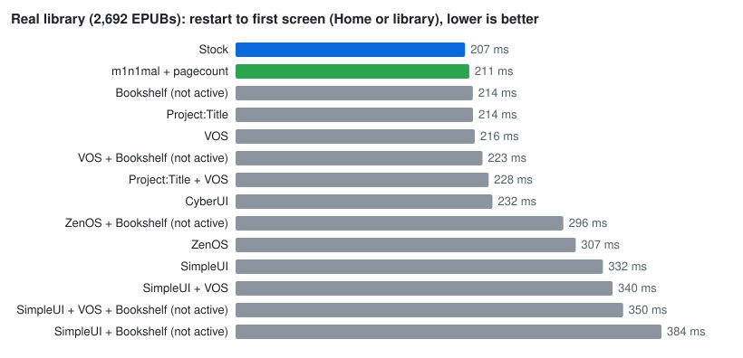
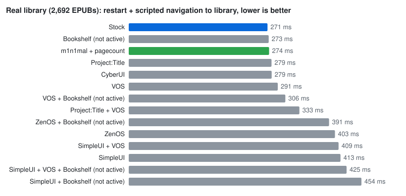
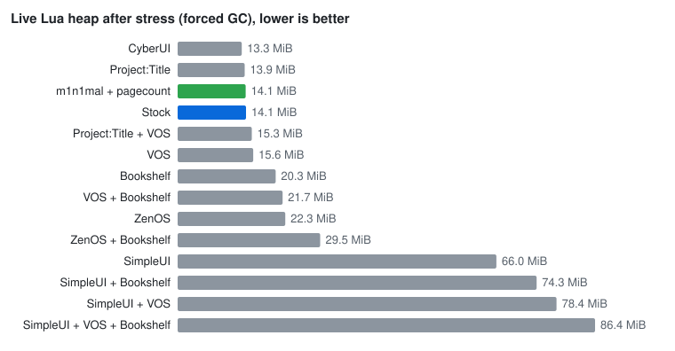
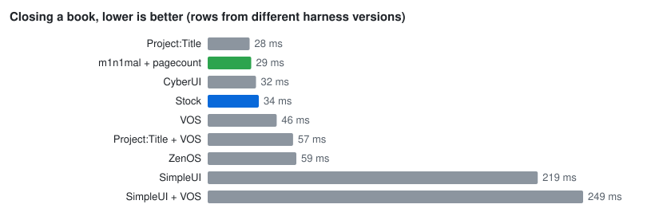

# KOReader UI Plugin Performance Benchmark

This repository measures the performance and retained runtime cost of KOReader UI plugins and plugin stacks in a pinned macOS SDL emulator.

It answers a practical question: **which UI changes stay close to Stock KOReader, and which trade more startup time or retained Lua state for a richer shell?**

> This is a controlled emulator comparison, not a benchmark of physical Kindle latency. It is useful for relative work, memory, and redraw comparisons; it cannot turn a Mac millisecond value into a Kindle millisecond value.

## Corrections after issue #2 (2026-11-05)

ZenOS's author [reported harness problems](https://github.com/d1-m4ss/kindle_benchmark/issues/2). Checked against the code and raw results:

- **ZenOS was built more often than Stock.** The adapter opened the Books tab and then forced a reinit in `home_to_library`, and did the same again in `library_first_render`. Fixed. Between campaigns, restart + navigation dropped from 461 to 403 ms, and library render from 33 to 17 ms (close to the harness's 16 ms frame floor; its page holds 5 entries). The navigation steps the fix touched account for about 16–31 ms of the drop across ZenOS and ZenOS + Bookshelf (about 23 ms by step medians); the rest is before the first screen, which the fix cannot affect, so it is not credited to the fix. Stock, re-measured as a control, moved from 269 to 271 ms.
- **"Restart" included scripted navigation to the library.** It is now two numbers: restart to the first screen, and restart plus navigation. The first screen is Home on ZenOS, SimpleUI and CyberUI and the library on Stock, and the check confirms the widget is on the stack, not that it has painted, so neither number is a like-for-like comparison of the same screen.
- **Bookshelf's library rows measured the stock browser with Bookshelf idle.** They were first labelled *not active*; as pointed out in the same issue, that was still misleading, so they are removed from the tables and charts. Its shelf has its own scenarios, and on 2026-11-07 it was measured at its own defaults and as the start page (see *Bookshelf at its own defaults*). Heap after stress stays, because the stress sequence opens the shelf, so that figure includes real use (before stress Bookshelf adds about 0.5 MiB, after it 6–8 MiB). The per-campaign reports linked above keep every raw row.
- **The same check on every other stack found more of this.** Unless an item says it was re-measured on 2026-11-07, nothing below was; the wording is corrected to what was actually exercised:
  - **Bookends ran disabled.** It defaults to off and the harness never enabled it, so it drew nothing. The first result was withdrawn; on 2026-11-07 it was re-measured enabled (see *Bookends control*).
  - **m1n1mal + pagecount (mine) ran mostly idle.** No page was counted, reader corner lines were never timed, and library paging frames are identical to Stock's. "As light as Stock" is not a result about the plugin's main jobs.
  - **Bookshelf's shelf ran with settings the harness chose:** `medium` animation (plugin default `fast`) and the `covers` view (default `spines`). Earlier text called it the default animation. Re-measured at the plugin's defaults on 2026-11-07, see below.
  - **VOS rows don't exercise its cover-grid code,** because the library is in list mode. Only its navbar and other non-grid changes are active.
  - **Close book compares different screens:** it returns to Home on SimpleUI, ZenOS and CyberUI and to the library on Stock.
- **The round-over-round comparison is withdrawn.** The earlier chart and per-plugin changes compared a windowed run with a headless one, where Stock itself restarted about twice as fast, so its ratios could move with no change in the plugin. The framebuffer was 1236×1648 in both rounds, so resolution was not the cause. The window versus headless setup is the likely one, though the harness also changed and no controlled run isolates it. Old plugin versions were not re-measured, so this README no longer claims how any plugin changed between rounds.
- SimpleUI's first-screen check used to settle for 4 ticks and every other stack for 2. All stacks now use the same rule. Its effect is not separable from run-to-run noise.
- **SimpleUI had the same kind of harness cost.** Its adapter always navigated to the library before the action being measured, on `library_first_render`, sort and quick settings. Fixed in `2026-11-06-simpleui`: library render dropped from 51–67 to 49–53 ms and sort from 144–178 to 132–150 ms across its four stacks, and a render's screen refreshes from 6 to 3. Stock does 1; the remaining 3 were not attributed. Restart + navigation dropped by 11–48 ms; about 6–29 ms of that comes after the first screen, where the fix acts, and the rest is not credited to it.

## Quick links

- Campaigns of 2026-11-07 (Bookends enabled, Bookshelf at its defaults): [Phase 2](results/runs/2026-11-07-defaults-2/phase2/REPORT.md), [Bookends control](results/runs/2026-11-07-defaults-2/phase2/BOOKENDS_REPORT.md), repeats [1](results/runs/2026-11-07-rep1/phase2/BOOKENDS_REPORT.md), [2](results/runs/2026-11-07-rep2/phase2/BOOKENDS_REPORT.md), [3](results/runs/2026-11-07-rep3/phase2/BOOKENDS_REPORT.md)
- Campaigns of 2026-10-27 (reports with all scenarios): [all stacks, Phase 1](results/runs/2026-10-27-m1n1mal-v3/phase1/REPORT.md) and [Phase 2](results/runs/2026-10-27-m1n1mal-v3/phase2/REPORT.md); [Project:Title with covers](results/runs/2026-10-27-pt-covers/phase2/REPORT.md); [VOS v1.4.1 stacks](results/runs/2026-10-27-vos-141/phase2/REPORT.md); [Bookends control, withdrawn: ran disabled](results/runs/2026-10-27-bookends/phase2/BOOKENDS_REPORT.md). Each row in the tables below comes from the newest campaign that measured it.
- Earlier (older pins): [2026-09-03 Phase 1](results/runs/2026-09-03-full/phase1/REPORT.md), [Phase 2](results/runs/2026-09-03-full/phase2/REPORT.md), [100 ms flash-delay study](results/runs/2026-09-03-flash100/phase1/REPORT.md)
- [Campaign runbook](RUNBOOK.md) · [Scenario definitions](SCENARIOS.md) · [Plan: benchmark on a real Kindle](docs/DEVICE_BENCHMARK_PLAN.md)

## Results at a glance (2026-10-27 to 2026-11-07)

Real library of 2,692 EPUBs, KOReader v2026.07.2 in the SDL emulator, each plugin at the pinned version listed below (some have newer releases since).

| | Result |
|---|---|
| **Close to Stock** | Project:Title (cover list on), VOS (list mode, so its cover-grid code is not exercised) and my own m1n1mal + pagecount (mostly idle: no pages counted, corner lines not timed): restart + navigation 271–291 ms including Stock, 14–16 MiB live Lua heap. |
| **Heaviest** | SimpleUI: restart to Home 332–340 ms, with navigation 409–413 ms, 66–78 MiB heap, 219–249 ms to close a book (Stock: 34 ms, but SimpleUI returns to its Home and Stock to the library). Home as the start page is set by the harness; SimpleUI's default is the file manager. |
| **In between** | ZenOS: restart to Home 307 ms, with navigation 403 ms, 22 MiB. |
| **Bookends** | Enabled, four separate processes against Stock: slower in book page turns in all four, median 11.7–12.7 ms against 4.1–5.5, but the size and cause are not isolated (some turns are as fast as Stock's, others one 16 ms frame slower). Minimal open book +5 to +9 ms. +8 MiB live heap after stress (14.5–15.9 → 22.6–24.2 MiB). Closing a book is not claimed (frames match Stock's in 8–9 of 10). |
| **Bookshelf's own shelf** | In the `covers` view (harness choice, default `spines`): page turn 133 ms with `medium` animation (harness choice, default `fast`), 38 ms (fastest 22 ms) with it off. Stock's list, a different screen, takes 16.6 ms. Live Lua heap after the stress sequence, which uses the shelf: 20.3 MiB (Stock 14.0), and 6–8 MiB more on top of VOS, ZenOS or SimpleUI. |
| **Bookshelf at its own defaults** | `fast` animation, `spines` view, one process; restart three times. Shelf opens in 28 ms; moving between its first two pages takes 101 ms (38 ms with animation off). Live heap after stress 24.6 MiB (Stock 14.1). As the start page, restart to the first screen is 376 ms versus 193 ms for Stock's library, which is a different screen. Sequential paging through the shelf is not checked in this view (see below). |
| **CyberUI** | Restart + navigation 279 ms, 13.3 MiB heap, close book 32 ms: close to Stock. Its own library actions finish within one frame (action CPU 1.5–2.1 ms vs 20–44 ms for Stock's render/sort, the call only, not the paint that follows), so their wall times sit at the harness's 16 ms frame floor. |
| **Correction** | Project:Title's lead in the earlier report came from running without its cover list. With covers it is about as light as Stock, not clearly faster. |
| **Library paging** | 14.8–17.4 ms per page for every stack, distributions overlap: no ranking. |









**m1n1mal + pagecount** is my own minimal plugin pair (quick panel, corner status lines, background page counts on top of KOReader's own library). I made it for myself and have not published it yet; it is included only as a reference point. Page counting was not running in these campaigns and reader corner lines were not timed, so its numbers do not cover those jobs.

Emulator on Apple Silicon, not a Kindle: read the numbers as relative. Tables for every stack and the synthetic libraries follow below; `scripts/make_summary_charts.py` regenerates the charts from the published CSVs.

## Details: campaigns, tables and notes

**Test dates: 2026-10-27 to 2026-11-07** (all campaigns below, same host and pinned KOReader).
The current numbers come from eleven campaigns, each measuring only the configs
it names. The 2026-10 campaigns share harness behaviour for the scenarios they have in common;
the 2026-11 campaigns differ from them (see below):

- `2026-10-27-m1n1mal-v3`: all 14 stacks at the pins listed under *Pinned
  software* (VOS at v1.4). Its Project:Title and VOS rows are superseded.
- `2026-10-27-pt-covers`: Project:Title alone with the cover list enabled.
  (It also contains a Project:Title + VOS run on VOS v1.4, superseded below.)
- `2026-10-27-vos-141`: every VOS-containing stack on VOS v1.4.1.
- `2026-10-27-bookends`: Stock versus Stock + Bookends, withdrawn because Bookends ran disabled.
- `2026-11-07-defaults-2`: Bookends enabled against Stock (one of four processes), and Bookshelf at its own
  defaults, with and without `start_with = "bookshelf"`, against Stock. `2026-11-07-rep1` to `rep3` repeat the Bookends
  control. Their harness hash covers the working tree at the time, including changes not committed with this update (see below), so it cannot be reproduced from the committed harness alone.
- `2026-10-28-cyberui-b`: CyberUI alone.
- `2026-11-05-issue2`: Stock and every ZenOS stack again after the harness fixes
  above. It supersedes their earlier rows. Its harness also has other
  changes that are not committed to this repository yet, so it does not match the committed harness: it records time spent in screen refresh calls, `library_folder_back` no longer
  rebuilds at the root first, and `close_book`'s reset shows the book's page first. Stock's
  close book moved from 28.5 to 33.9 ms (cause not established), so Stock now sits above
  some stacks that were not re-run: do not rank small close-book differences across campaigns.
- `2026-11-06-simpleui`: every SimpleUI stack on the same harness plus the SimpleUI adapter
  fix. It supersedes their rows from `2026-11-05-issue2`.

The tables take each row from the newest campaign that measured it. The
campaigns have different runner hashes (Project:Title's first-run setup is no
longer pre-marked done, `--configs` scopes the Phase 2 gate, VOS keeps
`hide_empty_folders` off, results carry a `library_probe`), so they are
separate campaigns rather than one.

Every cell below is an emulator measurement; see the limits in the next
section.

- **Stock and m1n1mal + pagecount** are indistinguishable on the real
  library: steady restart + navigation 271–274 ms, library render 26–29 ms,
  open book 104–111 ms (single-process differences of a few ms are inside the
  run-to-run spread). The forced-GC live Lua heap after the stress sequence is about the same for Stock (14.0 MiB) and
  m1n1mal + pagecount (14.1 MiB). Its page counting was not running and its frames match Stock's while paging, so this says little about the plugin's main jobs.
- **Project:Title with the cover list on** is no longer clearly ahead: restart + navigation
  279 ms, open book 98 ms, but a sort change is slower than Stock and
  m1n1mal (see the cover-list cost table). Earlier versions of this README
  credited it with a large lead; that was measured without covers.
- **SimpleUI** keeps its larger startup and memory cost: restart + navigation
  409–413 ms, library render about 50 ms, 66–78 MiB live Lua heap, and about 219–249 ms
  to close a book (Stock: 34 ms; SimpleUI returns to its Home, Stock to the library).
- **ZenOS** restarts to Home in 307 ms, 403 ms with navigation, and renders the library
  in 17 ms; its page holds 5 entries, so paging comparisons are UX-level.
- **Bookshelf** is measured in its dedicated shelf, not as the library (at its own defaults it is in *Bookshelf at its own defaults*). There,
  the `medium` animation the harness sets (plugin default `fast`) dominates page-turn latency, in the `covers` view it also sets (default `spines`); animation-off isolates a
  much smaller renderer cost.
- **VOS v1.4.1** is close to v1.4 on the real library (restart + navigation 291 ms, open book
  112 ms). On the synthetic FLAT 2000 library its render time is higher (66 versus
  49 ms for v1.4 in the baseline campaign); that is one process per cell and was not
  investigated further. Its new automatic series folders are on by default. The library runs in list mode, so VOS's cover-grid changes are not exercised in any VOS row.
- **Library paging**: sequential 14.8–17.4 ms per page, cached 12.8–20.7 ms, for
  every stack; distributions overlap, so no paging ranking is claimed.

### Cover list cost, and how Project:Title is measured

A cover-list library (`list_image_meta`) costs more than the plain list. The
harness pre-marked Project:Title's first-run setup as done, so in campaigns up to
`2026-10-27-m1n1mal-v3` it never switched to its cover list, while every
CoverBrowser-based stack ran with covers (probe: `cover_build_ui=False` for
Project:Title). That compared a plain list with other stacks' cover lists.
The runner no longer pre-marks the setup, the `library_probe` field in each raw
result records the active mode, and Project:Title is now measured with covers
on (`cover_build_ui=true`, verified in all its warm results).

Controlled diagnostic (real 2692-book library, warm, median of 4 runs, ms;
not part of a published campaign):

| Stack | Open book (minimal) | Change sort | First render | Close book |
|---|---:|---:|---:|---:|
| Stock + cover list | 100.6 | 60.4 | 47.3 | 27.1 |
| m1n1mal + pagecount | 100.2 | 56.1 | 37.0 | 28.9 |
| Project:Title, covers on | 97.6 | 69.1 | 33.6 | 27.2 |
| Project:Title, no covers (the old measurement) | 94.9 | 39.4 | 26.2 | 24.3 |

Loading CoverBrowser with covers costs about 20 ms on a sort change, 17 ms on the
first render and 6–9 ms on opening a book, for every stack that uses it.

### Synthetic stress case: FLAT 2000

This table is the intentionally hostile case: 2,000 EPUBs in one folder. Values
are warm medians in milliseconds; every shown value has 10 measured samples after
two warmups, from a single process per stack. `Open book` is `open_book_minimal`,
isolated from dirty-region instrumentation. Differences of a few milliseconds are
inside the spread of one process; the SimpleUI and LeanUI open-book values
include effects of their own shells.

| Stack | Library render | Open book |
|---|---:|---:|
| CyberUI | 16.1 | 45.8 |
| ZenOS | 27.0 | 58.6 |
| LeanUI (local rebuild) | 36.6 | 56.5 |
| m1n1mal + pagecount | 38.0 | 59.7 |
| Stock | 42.7 | 58.6 |
| Project:Title | 44.1 | 50.9 |
| SimpleUI | 59.2 | 95.2 |
| Project:Title + VOS | 61.0 | 45.5 |
| VOS | 66.1 | 47.9 |
| SimpleUI + VOS | 68.0 | 87.1 |

### Real library: 2,692 EPUBs

`Real 2692` is the total corpus size. Real paging traverses the library root,
which contains exactly **505 visible entries: 500 EPUBs + 5 folders**. The other
2,192 EPUBs remain inside those folders and still participate in indexing,
metadata/cache growth, folder navigation and the remaining Phase 2 scenarios.

The real corpus is the more practically useful result set. Restart values are the median of three isolated process runs; render/open values are warm medians of 10 samples. Memory is one forced-GC checkpoint per stack after the same stress sequence, so it is an observed state point, not a replicated statistical median.

| Stack | Restart → first screen | Restart + navigation to library | Library render | Open book | Live Lua after stress (forced GC) |
|---|---:|---:|---:|---:|---:|
| Stock | 207 ms | 271 ms | 29.1 ms | 103.9 ms | 14.0 MiB |
| m1n1mal + pagecount | 211 ms | 274 ms | 26.3 ms | 110.8 ms | 14.1 MiB |
| Project:Title | 214 ms | 279 ms | 30.4 ms | 98.1 ms | 13.9 MiB |
| CyberUI | 232 ms | 279 ms | 16.1 ms | 93.5 ms | 13.3 MiB |
| VOS | 216 ms | 291 ms | 34.5 ms | 112.5 ms | 15.6 MiB |
| LeanUI (local rebuild) | 258 ms | 323 ms | 31.7 ms | 99.3 ms | 15.0 MiB |
| Project:Title + VOS | 228 ms | 333 ms | 45.9 ms | 104.6 ms | 15.3 MiB |
| ZenOS | 307 ms | 403 ms | 17.3 ms | 126.1 ms | 22.2 MiB |
| SimpleUI + VOS | 340 ms | 409 ms | 49.5 ms | 129.2 ms | 77.9 MiB |
| SimpleUI | 332 ms | 413 ms | 50.0 ms | 119.3 ms | 66.0 MiB |

LeanUI runs as a compact list without covers at a harness-set 14 entries per page, so it does not carry the cover-list cost noted for Project:Title.

Stacks with Bookshelf appear only for heap. Their stress sequence also opens the shelf, which other stacks don't have, so this is not the same workload: Bookshelf 20.3 MiB, VOS + Bookshelf 21.7, ZenOS + Bookshelf 29.5, SimpleUI + Bookshelf 74.1, SimpleUI + VOS + Bookshelf 85.9.

`RSS` is recorded too, but it is the whole macOS emulator process. It includes native libraries, mappings, allocator behaviour, and cached allocations, so forced-GC live Lua heap is the cleaner plugin-side signal.

### Real-library paging

Warm medians (and, in brackets, the fastest iteration) of 30 transitions per stack in the Phase 2 library root (505 entries:
500 EPUBs + 5 folders). `Entries/page` is the visible page size; comparisons across
different layouts are UX-level, not equal-render-work claims. The dedicated
three-process paging phases were not repeated in this round.

| Stack | Entries/page | Sequential, ms: median (min) | Cached, ms: median (min) |
|---|---:|---:|---:|
| Project:Title | 7 | 14.8 (12.0) | 20.7 (8.5) |
| Project:Title + VOS | 7 | 15.1 (12.7) | 18.6 (9.0) |
| SimpleUI | 9 | 15.3 (8.0) | 13.5 (11.1) |
| VOS | 10 | 15.4 (13.3) | 14.7 (9.1) |
| LeanUI (local rebuild) | 14 | 16.0 (12.7) | 16.1 (15.6) |
| ZenOS | 5 | 16.1 (5.6) | 16.1 (6.6) |
| SimpleUI + VOS | 9 | 16.1 (8.3) | 12.8 (9.7) |
| CyberUI | 8 | 16.1 (10.7) | 16.1 (9.2) |
| Stock | 10 | 16.6 (9.8) | 16.8 (9.1) |
| m1n1mal + pagecount | 10 | 17.4 (13.6) | 15.7 (10.6) |

The separate `2026-09-03-flash100` sensitivity study added approximately
97–106 ms to the median library transition. It is an injected SDL delay, not a
physical Kindle model.

### CyberUI

CyberUI v1.0.0 (latest stable when measured) was added at a contributor's request (campaign `2026-10-28-cyberui-b`, 0 FAILED). It is a full-screen home plus its own library that sits above the stock browser, so the harness sets it as the start page and drives its screens directly; it has no quick-settings panel, so those two scenarios are UNSUPPORTED. Its library actions finish in one frame: action CPU 1.5-2.1 ms versus 20-44 ms for Stock's render, sort and folder enter. The wall times are therefore pinned at the harness's 16 ms frame floor (16.1 ms), so differences below one frame are not measurable here; close book (32 ms) and restart + navigation (279 ms) are close to Stock. Its sort scenario uses the two of its four sort orders that show different books on page one for the corpus.

### Bookends control

The `2026-10-27-bookends` campaign compared Stock with Stock + Bookends, but Bookends defaults to off and the harness never enabled it: no top-level `enabled` in its settings, and frames identical to Stock's for reader page turn, open book and close book. Opening a book did make 2 more screen refreshes than Stock, consistent with the overlay widget `Bookends:init()` shows whether enabled or not. Its numbers (page turn 4.7 → 16.7 ms and the verdict built on them) are withdrawn: they describe the plugin switched off.

On 2026-11-07 the harness turned it on (`enabled = true`, everything else at the plugin's defaults, so its default preset applies) and measured Stock against Stock + Bookends in four separate processes (`2026-11-07-defaults-2`, `rep1` to `rep3`; one process per variant each, 10 samples per scenario). The frames now differ from Stock's. Median of the 10 samples in each process, in ms:

| Scenario | Stock | + Bookends | Difference per process |
|---|---|---|---|
| Reader page turn | 5.5, 4.1, 4.1, 4.1 | 12.7, 12.6, 11.7, 12.1 | +7.2, +8.5, +7.6, +8.0 |
| Open book (minimal) | 95.7, 97.8, 95.7, 100.5 | 101.1, 103.4, 104.3, 107.7 | +5.4, +5.7, +8.6, +7.2 |
| Close book | 27.5, 28.1, 27.7, 21.8 | 33.3, 29.7, 34.1, 23.5 | +5.8, +1.6, +6.4, +1.7 |
| Open book (with instrumentation) | 42.5, 52.6, 51.6, 63.2 | 69.8, 69.0, 64.5, 61.0 | +27.3, +16.4, +12.9, −2.2 |
| Live Lua heap after stress, MiB | 15.2, 14.6, 14.5, 15.9 | 23.0, 23.5, 22.6, 24.2 | about +8 (stress checkpoint; the generated Bookends reports show reader-cycle heap, +2.4 to +4.3 MiB, a different measure) |

Page turns, minimal open book and heap are higher with Bookends in all four processes; the size of the page-turn difference is not isolated. Per process, 0 to 2 of Stock's 10 turns take 10 ms or more, against 5 to 8 of Bookends' 10 (in `rep3` its first five are under 10 ms, then the last five are 14.9–16.3 ms), so the median mixes "same as Stock" with "one 16 ms frame later", and CPU time in the action is about the same. Stock always ran about 12 s before Bookends (no alternating order), and the withdrawn run showed +12 ms for the disabled plugin with identical frames, so loading the plugin cannot be separated from drawing with it. Close book, where frames match Stock's in 8–9 of 10, and the instrumented open book vary too much to claim a size. These are emulator timings, one process per variant in each campaign, with Bookends at its default preset only.

### Bookshelf at its own defaults

Earlier shelf numbers ran with harness-chosen settings. On 2026-11-07 Bookshelf was measured with its animation (`fast`) and Home view (`spines`) left at the plugin's defaults, on the real library, once as an added plugin and once as the start page (`start_with = "bookshelf"`), against Stock in the same campaign (`2026-11-07-defaults-2`). One warm process each; restart is three processes.

| | Stock | Bookshelf at defaults |
|---|---:|---:|
| Library paging, sequential (stock browser) | 15.3 ms | 15.2 ms |
| Open book (minimal) / close book | 92.3 / 27.8 ms | 101.0 / 31.9 ms |
| Restart to first screen / with navigation | 193 / 249 ms | 198 / 255 ms |
| Live Lua heap after stress | 14.1 MiB | 24.6 MiB |
| Open shelf / first render / close shelf | | 28.0 / 20.6 / 6.8 ms |
| Shelf, page 1↔2 turn (animation `fast`) / animation off | | 100.9 / 38.0 ms |
| As start page: restart to first screen / with navigation | 193 / 249 ms | 376 / 432 ms |

Compare within this campaign only: its Stock differs from the Stock row in the real-library table above, because that comes from another campaign. The start-page row compares different screens: Bookshelf's shelf against Stock's library, and the first-screen check only confirms the widget is on the stack, not that it has painted. Opening a book (minimal) is 8.7 ms slower with Bookshelf loaded; the instrumented open book differs more (49.8 versus 77.5 ms) and the cause was not investigated. Sequential paging through the shelf is not checked in this view: in the first attempt a next-page turn from page 3 stayed on page 3 (each page showed 84 books, 33 pages), so the strict one-page-forward check failed once. Pages in this view hold a variable number of books, which may be the cause, but a Bookshelf bug or harness timing is not excluded and was not investigated. The scenario is recorded as unsupported with that reason in the raw result (not published; the generated report shows "—"). The shelf's cached paging only alternates pages 1 and 2, so this view is not exercised beyond page 2. The harness writes no animation setting at the start (the plugin's own `fast` applies), but it saves `fast` explicitly just before the animation-on measurement; the value read before that is not in the raw results.

## What was tested

The harness uses a backend-specific adapter for each UI stack. A scenario is `PASS` only when its semantic postcondition succeeds; unsupported UI actions remain `UNSUPPORTED` and are never converted into zero-latency samples.

Core scenarios include:

- process spawn to usable UI and usable library;
- library first render, page navigation, folder navigation, and sort change;
- open and close book;
- quick/settings panel transitions;
- short navigation stress and memory checkpoints;
- dedicated Bookshelf open/render/page/close scenarios;
- a separate Bookends reader control;
- refresh and dirty-region accounting.

The primary open-book number is `open_book_minimal`, which avoids distorting the latency with full dirty-region instrumentation. The report retains the full-instrumented scenario separately.

## Published campaign status

Campaigns [`2026-09-03-full`](results/runs/2026-09-03-full/campaign.json),
[`2026-09-03-bookends10-fixed`](results/runs/2026-09-03-bookends10-fixed/campaign.json)
and [`2026-09-03-flash100`](results/runs/2026-09-03-flash100/campaign.json) were
generated by the code and dependency revisions recorded in their metadata. These
are aggregated report rows, not a count of individual warm iterations:

| Scope | PASS | FAILED | UNSUPPORTED |
|---|---:|---:|---:|
| Baseline Phase 1 | 1,520 | 0 | 136 |
| Baseline Phase 2 | 611 | 0 | 6 |
| Bookends control | 38 | 0 | 2 |
| Flash100 paging study | 276 | 0 | 0 |

Campaigns `2026-10-27-m1n1mal-v3` and `2026-10-27-pt-covers` (14 stacks and the
Project:Title re-run) report 1,440 + 180 PASS in Phase 1 and 545 + 72 PASS in
Phase 2 with 0 FAILED; their UNSUPPORTED rows (156 + 20 and 8 + 2) are the same
kind of stack-specific gaps. `2026-10-27-vos-141` adds 498 + 196 PASS (Phase 1 and
2, 0 FAILED), and `2026-10-27-bookends` 38 PASS. The `2026-10-27-m1n1mal-v3`
Project:Title and VOS rows are superseded by `2026-10-27-pt-covers` and
`2026-10-27-vos-141`. `2026-11-05-issue2` reports 738 PASS in Phase 1 and 279 PASS in Phase 2 with
0 FAILED (70 and 1 UNSUPPORTED), and `2026-11-06-simpleui` 424 and 162 PASS with 0 FAILED (40 and 0 UNSUPPORTED).
`2026-11-07-defaults-2` ran 16 jobs with 0 FAILED; one earlier attempt (`2026-11-07-defaults`) failed on Bookshelf sequential paging in its default view and is not used.

`UNSUPPORTED` entries describe actions that do not exist for the relevant stack or corpus shape, such as next-page navigation in a single-page library. They are reported explicitly rather than treated as success or as `0 ms`.

## Test environment

### Host and emulator target

- Apple MacBook Pro with M4 Pro, arm64
- macOS / Darwin 27
- Python 3.14.7
- KOReader SDL emulator hard-gated to 1236 × 1648, 300 DPI, grayscale
- Kindle Paperwhite 11th-generation / PW5-style framebuffer

SDL logical window size and actual render-output size can differ on Retina macOS. The runner aborts unless the actual framebuffer is 1236 × 1648.

### Pinned software

Only tagged stable releases are pinned. Pre-release tags are deliberately excluded (for example the ZenOS `v4.3.0-alphaN` tags), and Project:Title is pinned to the `2026.07-v3.8.3` tag rather than a commit after it. KOReader is on its latest stable release. VOS v1.4.1 changed the default of `hide_empty_folders` to on, which makes VOS leave any empty folder it is asked to open. The flat synthetic libraries have no real subfolder (the folder-enter target is a book's empty `.sdr` sidecar directory), so the harness turns that single VOS option off; every other VOS setting stays at its default.

| Component | Release | Commit |
|---|---|---|
| KOReader | [`v2026.07.2`](https://github.com/koreader/koreader/releases/tag/v2026.07.2) | `9192014d8bd82a91dc1012473be0f238dedfdb54` |
| KOReader base | v2013.03-3987-g6e4bc81 | `6e4bc81af4e04f78d81677a323a780a71b29702a` |
| SimpleUI | [`3.0.1`](https://github.com/doctorhetfield-cmd/simpleui.koplugin/releases/tag/3.0.1) | `e5cd6dcb31fa759b9831223d4719f61126367cff` |
| ZenOS | [`v4.2.0`](https://github.com/xZenLabs/zen-os/releases/tag/v4.2.0) | `a2d7230110eb1fa6f9e2e29944c49e5607a82bd6` |
| Bookshelf | [`v6.0.3`](https://github.com/AndyHazz/bookshelf.koplugin/releases/tag/v6.0.3) | `c37580a1ca5040d2423e45b9bdd429776117f3c1` |
| Bookends | [`v5.31.0`](https://github.com/AndyHazz/bookends.koplugin/releases/tag/v5.31.0) | `8f6e1c6b5770864e0cfed6be93435b5d6427eba5` |
| Project:Title | [`2026.07-v3.8.3`](https://github.com/joshuacant/ProjectTitle/releases/tag/2026.07-v3.8.3) | `f29b5328f408362a95282ed8786a5b691536260c` |
| VOS | [`v1.4.1`](https://github.com/SeriousHornet/vos.koplugin/releases/tag/v1.4.1) | `a5c91d882290af68b437c049bed10e03a3b03be4` |
| CyberUI | [`v1.0.0`](https://github.com/EmirErtorer/CyberUI.koplugin/releases/tag/v1.0.0) | `b7e61e0fe34bc8a650b37da335a1a73a1b234ded` |
| LeanUI (abandoned local rebuild) | `rebuild-local-2026-10-27` (local) | `5c5b2d5bcdfefccfc3a65d218c1cf913b2fec3d8` |
| m1n1mal (my own plugin, not published yet) | `local-2026-10-27` (local) | `44ea3f53b2ae4903497735d067b74b78214b4b1b` |
| pagecount (part of m1n1mal, not published yet) | `local-2026-10-27` (local) | `44ea3f53b2ae4903497735d067b74b78214b4b1b` |

`versions.lock.json` is the single source of truth. `setup.sh` and `scripts/run_benchmarks.py` both read it, so bumping a dependency is a one-file edit:

1. Change `tag`, `commit`, `date`, `release_url` and `tree_url` for that entry.
2. Run `./setup.sh`. It checks out the pinned revisions and fails if any checkout drifts from the lock file.
3. Run `./build.sh` if KOReader itself changed.
4. Start a **new campaign**. The lock file's SHA-256 is part of the campaign identity, so a running campaign refuses to mix revisions and results from different locks are not comparable.

#### Baseline change

For `2026-10-27-*` the plugins were moved to their latest stable releases: SimpleUI 2.7.1 → 3.0.1, ZenOS v3.3.1 → v4.2.0, Bookshelf v5.2.1 → v6.0.3, Bookends v5.26.0 → v5.31.0, VOS v1.3.4 → v1.4.1. SimpleUI 3.0 starts in the file manager by default, so the harness now sets `start_with = homescreen_simpleui` to keep measuring it from its Home Screen. m1n1mal and pagecount (a small quick panel, corner lines and background page counts on top of KOReader's own library) were added as stack `N`. Earlier campaigns used older pins and are not comparable.


The pinned revisions above changed after the `2026-08-31-fixed` campaign was published: KOReader `1e2fa5f1` → `9192014d`, KOReader base `6232b260` → `6e4bc81a`, Bookshelf `643bc21f` (v4.4.0) → `c20ffdec` (v4.4.1), Project:Title `4dc97e62` → `f29b5328`. The published `2026-08-31-fixed` campaign predates this bump and also predates the paging-instrumentation and hierarchical-dataset fixes below — its paging/cached-paging numbers are not comparable to a campaign run against the current pinned revisions. See the deprecation banner in that campaign's phase1/phase2 reports.

## Corpus and design

### Phase 1: deterministic synthetic libraries

The synthetic corpus generator produces four shapes:

- FLAT 50
- FLAT 2000
- HIERARCHICAL 50
- HIERARCHICAL 2000

The FLAT 2000 directory is deliberately hostile: it concentrates listing, sorting, pagination, and widget construction in one folder. The hierarchical layouts better resemble ordinary libraries.

Phase 1 stacks:

| ID | Stack |
|---|---|
| A | Stock KOReader |
| B | Bookshelf |
| C | SimpleUI |
| D | ZenOS |
| E | Project:Title |
| F | VOS |
| G | SimpleUI + Bookshelf |
| H | ZenOS + Bookshelf |
| I | VOS + Bookshelf |
| J | SimpleUI + VOS |
| K | SimpleUI + VOS + Bookshelf |
| L | Project:Title + VOS |
| M | LeanUI (local rebuild) |
| N | m1n1mal + pagecount |
| O | CyberUI |

### Phase 2: your real library

The published run used 2,692 EPUB files in a hierarchical personal library. The books are not and must not be included in this repository.

Place your own EPUB collection under exactly this path before Phase 2:

```text
real_books/
```

For example, the directory may look like this:

```text
real_books/
├── Fiction/
│   ├── Author A/
│   │   └── Title.epub
│   └── Author B/
│       └── Another title.epub
└── Non-fiction/
    └── Topic/
        └── Book.epub
```

The runner creates isolated working state per stack so one stack does not intentionally reuse another stack's KOReader/plugin cache.

#### Working-corpus layout

`real_books/` is never modified. For each stack the runner clones it into a disposable working corpus under `work_real/<campaign>/<config>/corpus`, restructured so the library is measurable:

```text
corpus/
├── <500 EPUBs in the root>   # sequential and cached library paging
├── folder1/                  # 500 books
├── folder2/                  # 500 books
├── folder3/                  # 500 books
├── folder4/                  # 500 books
└── folder5/                  # remaining books
```

Every book is preserved, so the corpus still totals 2,692 files; duplicate filenames across the master tree are disambiguated deterministically. Two reasons for the restructure:

- A personal library keeps no books in its root, so a paged library view there has a single page and cannot be measured at all. 500 books in the root give at least 30 sequential page transitions for every UI, including the densest measured layout at 14 entries per page.
- `folderN` names replace personal folder names, so the corpus structure itself carries nothing private. Book filenames stay real locally, because sorting and metadata parsing are part of what is measured. Published manifests retain aggregate corpus metadata only; raw evidence may be published only after `scripts/sanitize_published_results.py` hashes values exposing local paths.

Every paging metric — library and Bookshelf alike — therefore measures the same 505-entry root listing on every stack: 500 EPUBs plus 5 folders. The Bookshelf `all` shelf is not recursive: it lists the current folder, so it shows those 500 books plus the five folder entries, and no book from `folderN` appears in a shelf page turn. The remaining books are not decoration; they are what the rest of Phase 2 needs: first-run metadata and cover cache growth, `cache_database_bytes`, RSS and forced-GC live-heap checkpoints after real stress, folder navigation, and library first render. The exact mapping is recorded in `real_corpus_manifest.json` under `working_corpus_layout`.

#### Reader page turns

`reader_page_turn` is measured inside one pinned document, chosen deterministically from the books nearest the corpus median size. Page-turn latency tracks document size and complexity, and this corpus spans 59 KB to 29 MB, so rotating books would blend unrelated documents into one median. `open_book` deliberately keeps rotating through ten deterministic books, because opening the same file repeatedly would measure a warm document cache instead of a cold open.

Phase 2 uses the same 15 stacks (A–O above): Stock, Bookshelf, SimpleUI, ZenOS,
Project:Title, VOS, SimpleUI + Bookshelf, ZenOS + Bookshelf, VOS + Bookshelf,
SimpleUI + VOS, SimpleUI + VOS + Bookshelf, Project:Title + VOS, LeanUI, m1n1mal + pagecount and CyberUI. Bookends
is the separate controlled Stock comparison described above.

## Run it

Run all commands from the repository root. Full runs are expensive and create generated environments/results; use a new campaign name when you need a clean rerun. Measurement phases require `--lanes 1`; only `--validate` accepts up to `--lanes 2`.

[`RUNBOOK.md`](RUNBOOK.md) is the step-by-step operational procedure for a full campaign, including what each audit line must show, how to run the flash study, and how to publish. Follow it rather than assembling commands ad hoc.

### 1. Set up dependencies and pinned sources

```bash
./setup.sh
```

The script fetches KOReader and the plugin repositories at the revisions in `versions.lock.json`.

### 2. Build the KOReader emulator

```bash
./build.sh
```

### 3. Generate deterministic synthetic libraries

```bash
./prepare_library.sh
```

### 4. Run the validation gate

```bash
python3 scripts/run_benchmarks.py \
  --validate \
  --campaign local-run \
  --lanes 1
```

Validation checks framebuffer geometry, sub-millisecond timing, plugin loading, semantic postconditions, no fake zero-latency transition, dirty-region invariants, and instrumentation overhead.

### 5. Run the paging phases

Paging is measured on its own, isolated from startup, memory and open-book work, with three independent processes per cell:

```bash
# 72 jobs: 12 configs x {FLAT 2000, HIERARCHICAL 2000} x 3 processes
python3 scripts/run_benchmarks.py \
  --paging-phase1 \
  --paging-runs 3 \
  --campaign local-run \
  --lanes 1

# 36 jobs on the real corpus; requires a complete --paging-phase1
python3 scripts/run_benchmarks.py \
  --paging-phase2 \
  --paging-runs 3 \
  --campaign local-run \
  --lanes 1
```

### 6. Run full synthetic Phase 1

Only needed for startup, memory and open-book measurements; skip it for a paging-only campaign.

```bash
python3 scripts/run_benchmarks.py \
  --phase1 \
  --batch all \
  --campaign local-run \
  --lanes 1
```

Use `--batch 1` or `--batch 2` for a resumable half. Phase 1 refuses to proceed without a valid validation gate for that campaign.

### 7. Add your books and run real-library Phase 2

After placing exactly 2,692 EPUBs in `real_books/`, run:

```bash
python3 scripts/run_benchmarks.py \
  --phase2 \
  --campaign local-run \
  --lanes 1
```

Do not commit copyrighted books, generated KOReader homes, caches, emulator build output, or transient logs.

### 8. Run the Bookends control

This is Phase 2 batch 3 and requires a complete Phase 1 and Phase 2:

```bash
python3 scripts/run_benchmarks.py \
  --phase2 \
  --batch 3 \
  --campaign local-run \
  --lanes 1
```

For a focused Bookends-only repair/control, use a new standalone campaign. This
does not rerun or claim completion of the other phases:

```bash
python3 scripts/run_benchmarks.py \
  --bookends-control \
  --campaign local-bookends-control \
  --lanes 1
```

### 9. Run the flash study as its own campaign

`EMULATE_READER_FLASH` is part of the campaign identity, so a flash run never shares a campaign with the baseline and needs its own validation gate:

```bash
python3 scripts/run_benchmarks.py --validate \
  --campaign local-flash100 --emulate-reader-flash-ms 100 --lanes 1

python3 scripts/run_benchmarks.py --paging-phase1 --paging-runs 3 \
  --campaign local-flash100 --emulate-reader-flash-ms 100 --lanes 1
```

This is a synthetic SDL flash-delay sensitivity experiment. It does not model persistent e-ink ghosting and is not a physical-Kindle latency measurement.

### 10. Regenerate reports from existing raw data

This is read/compute-only with respect to a completed run; it does not rerun the emulator scenarios:

```bash
python3 analyze_results.py \
  --run-dir results/runs/local-run/phase1 \
  --scope phase1

python3 analyze_results.py \
  --run-dir results/runs/local-run/phase2 \
  --scope phase2

python3 analyze_results.py \
  --run-dir results/runs/local-run/phase2 \
  --scope bookends_control

python3 analyze_results.py \
  --run-dir results/runs/local-flash100/phase1 \
  --scope phase1
```

## Result layout

Each campaign is stored under `results/runs/<campaign>/`:

```text
results/runs/<campaign>/
├── campaign.json
├── phase1/
│   ├── raw/                  # source-of-truth schema-v2 measurements
│   ├── charts/
│   ├── RESULTS.csv
│   ├── VALIDATION.md
│   └── REPORT.md
└── phase2/
    ├── raw/
    ├── charts/
    ├── real_corpus_manifest.json
    ├── RESULTS.csv
    ├── BOOKENDS_RESULTS.csv
    ├── BOOKENDS_REPORT.md
    └── REPORT.md
```

Local runs also maintain `logs/` and `checkpoints/` for diagnostics and resume safety.

Publication is opt-in per campaign. `.gitignore` tracks only campaigns listed there explicitly, and only their aggregates: `campaign.json`, `environment.json`, `*.csv`, `charts/`, `REPORT.md`, `VALIDATION.md`. `raw/`, `logs/`, `checkpoints/` and `screenshots/` stay local — they are large, and on the real corpus raw evidence carries EPUB filenames. To publish a campaign, add one `!results/runs/<campaign>/` line. To publish its raw measurements too, first run `scripts/sanitize_published_results.py --run-dir <campaign>`, which hashes every value exposing a local path, then confirm with `--check`.

## Reading the measurements

Internal UI timings use KOReader's monotonic clock with microsecond representation:

```lua
time.to_us(time.monotonic() - t0) / 1000.0
```

External process timing uses Python's monotonic high-resolution clock. Warm scenarios use two warmups and 10 measured iterations. Startup/restart measurements use independent emulator processes; the published real-library steady restart median has three runs, and first-run initialization is descriptive rather than extensively replicated.

Memory checkpoints record natural Lua heap, forced-GC live Lua heap, RSS, KO_HOME/cache/database size, and related dirty-region metrics. `RSS` is supporting evidence rather than a clean measure of plugin memory on macOS.

Dirty-region output records refresh calls, full/partial refresh counts, cumulative dirty screen-equivalents, geometric union of dirty area, and largest dirty region. It measures redraw requests in the emulator, not physical Kindle waveform timing or ghosting.

### Why Bookshelf has no `library_*` rows in the tables

Bookshelf is a separate widget, not a replacement for KOReader's file browser. The
`library_*` scenarios (first render, next page, sort, folder navigation) therefore
measure the stock browser with Bookshelf loaded and idle; the screens for `A_stock` and
`B_bookshelf` are identical. Those rows stay in the raw results but are left out of the tables
and charts, since they say nothing about using the plugin. Only the
`bookshelf_*` scenarios exercise the shelf itself, and `start_with = "bookshelf"` was measured on 2026-11-07 (see *Bookshelf at its own defaults*). Stacks that do replace the browser
(SimpleUI, ZenOS, Project:Title) are measured on their own library views. The Bookshelf
shelf scenarios walk explicit page transitions and fail on a no-op turn, an empty shelf or
an unchanged visible signature (the `noops` / `empty_shelves` audit counters).

### One-sided timing noise

Contention, scheduling and thermal effects can only make an iteration slower, so a
timing distribution is the true cost plus non-negative noise: its minimum (or a low
percentile) is a steadier estimator than the median or mean, and the medians in the tables can
drift between runs by more than the within-run spread. The reports therefore publish the
minimum, p10 and p90 next to each median, and the tables here are descriptive. Where
distributions overlap (library paging in particular) no ranking is claimed. Ranking claims would
need several independent runs per cell and the same iteration count for everything compared.

### Linux and other hosts

The runner finds the emulator under `koreader_src/koreader-emulator-*-debug` or from
`$KOREADER_EMULATOR_DIR`. The published numbers were measured on macOS arm64 only.

## Limits

- The M4 Pro host does not reproduce Kindle CPU, storage I/O, memory-pressure, or E-Ink waveform behaviour.
- Results are descriptive local-emulator comparisons. They are not significance claims and do not select a universal winner.
- Exact rankings for close results can change on real hardware.
- A real Kindle follow-up is required for on-device latency or power conclusions.
- Published values apply to the pinned versions and corpus shape above, not to all plugin versions or libraries.

## License

Copyright (C) 2026 Dmytro Stadnik. The original code in this repository is
licensed under the GNU Affero General Public License, version 3 or later
([AGPL-3.0-or-later](LICENSE)).

## Attribution

This project benchmarks KOReader and independent third-party plugins. Those projects retain their own licences and copyrights; see their upstream repositories and licence files.
